# Sistem Informasi Pengelolaan Surat Masuk dan Surat Keluar

Aplikasi berbasis web untuk membantu pengelolaan arsip surat masuk, surat keluar, disposisi, jenis surat, pengguna, dan laporan surat di **SMK Negeri 1 Tanjung Palas**.

## 📑 Daftar Isi

- [Latar Belakang](#latar-belakang)
- [Fitur Utama](#fitur-utama)
- [Hak Akses](#hak-akses)
- [Teknologi](#teknologi)
- [Struktur Proyek](#struktur-proyek)
- [Persyaratan](#persyaratan)
- [Instalasi dan Menjalankan Aplikasi](#instalasi-dan-menjalankan-aplikasi)
- [Basis Data](#basis-data)
- [Pengujian](#pengujian)
- [Catatan Keamanan Sebelum Dipublikasikan](#catatan-keamanan-sebelum-dipublikasikan)
- [Pengembangan Selanjutnya](#pengembangan-selanjutnya)

## 🎯 Latar Belakang

Pengelolaan surat secara manual dapat membuat pencatatan, pengarsipan, pencarian surat, penyampaian disposisi, dan pembuatan laporan menjadi kurang efisien. Aplikasi ini dibuat untuk memusatkan proses pengelolaan surat dalam satu sistem berbasis web sehingga data lebih mudah dicari dan dokumentasi surat lebih terorganisasi.

## ✨ Fitur Utama

Berdasarkan route, controller, model, dan halaman yang tersedia dalam kode:

- **Autentikasi pengguna** — halaman login dan mekanisme autentikasi Laravel.
- **Dashboard** — halaman ringkasan aplikasi setelah pengguna masuk.
- **Pengelolaan surat masuk** — melihat daftar, menambah, melihat detail/membuka berkas, mengubah, dan menghapus data surat masuk.
- **Pengelolaan surat keluar** — melihat daftar, menambah surat keluar, termasuk formulir surat keluar eksternal, melihat detail/membuka berkas, mengubah, dan menghapus data.
- **Konfirmasi surat keluar** — alur persetujuan atau penolakan surat keluar tersedia melalui route konfirmasi.
- **Disposisi surat** — melihat, menambah, melihat detail, mengubah, dan menghapus disposisi surat masuk.
- **Jenis surat** — pengelolaan data jenis surat.
- **Pengguna** — pengelolaan akun pengguna oleh level yang diizinkan.
- **Laporan berdasarkan periode tanggal** — laporan surat masuk, surat keluar, dan disposisi, termasuk halaman cetak laporan.
- **Berkas surat** — aplikasi memiliki alur untuk membuka berkas surat yang diunggah.

Ketersediaan menu atau tindakan tertentu dapat bergantung pada level akun yang sedang digunakan.

## 🔐 Hak Akses

Kolom `level` pada tabel `users` mendefinisikan nilai berikut:

| Nilai level di basis data | Peran |
|---|---|
| `tatausaha` | Tata Usaha / administrasi surat; kode membatasi pengelolaan jenis surat dan pengguna ke level ini. |
| `kepsek` | Kepala sekolah. |
| `kurikulum` | Bidang kurikulum. |
| `kesiswaan` | Bidang kesiswaan. |
| `humas` | Bidang hubungan masyarakat. |
| `sarpras` | Bidang sarana dan prasarana. |
| `guru` | Guru. |

Pembatasan hak akses pada route menggunakan middleware `auth` dan middleware `level`. Untuk penjelasan hak akses yang benar-benar berlaku di setiap halaman, periksa kembali tampilan dan controller terkait sebelum mengubah konfigurasi peran.

## 🛠️ Teknologi

| Teknologi | Kegunaan |
|---|---|
| PHP `^8.1` | Bahasa pemrograman sisi server; sesuai persyaratan di `composer.json`. |
| Laravel `^10.10` | Framework aplikasi web. |
| MySQL | Basis data yang dapat dikonfigurasi melalui `.env`; koneksi default di konfigurasi Laravel adalah MySQL. |
| Blade | Template tampilan Laravel (`resources/views`). |
| Bootstrap `^5.2.3` | Komponen dan styling antarmuka dari dependensi frontend. |
| AdminLTE | Aset template dashboard yang disertakan di direktori `public/Adminlte`. |
| DataTables | Dukungan tabel interaktif; dependensi `datatables.net-dt` tercantum di `package.json`. |
| Vite, npm | Pengelolaan dan build aset frontend. |
| DomPDF | Dependensi untuk pembuatan dokumen PDF. |

## 📂 Struktur Proyek

```text
surat-masuk-keluar-app/
├── app/
│   ├── Http/Controllers/       # Logika surat, disposisi, laporan, pengguna
│   ├── Http/Middleware/        # Middleware autentikasi dan level pengguna
│   └── Models/                 # Model Eloquent
├── database/
│   ├── migrations/             # Skema tabel
│   └── seeders/                # Seeder basis data
├── public/
│   ├── Adminlte/               # Aset template dashboard
│   ├── image/                  # Aset gambar/logo
│   └── uploadfile/             # Direktori berkas yang ada pada paket proyek
├── resources/views/            # Template Blade
├── routes/web.php              # Route aplikasi web
├── composer.json               # Dependensi PHP
├── package.json                # Dependensi frontend
└── vite.config.js              # Konfigurasi Vite
```

## Persyaratan

Pastikan perangkat pengembangan sudah memiliki:

- PHP **8.1 atau lebih baru yang kompatibel dengan Laravel 10**, beserta ekstensi PHP yang dibutuhkan Laravel dan driver PDO MySQL.
- Composer.
- MySQL atau MariaDB yang kompatibel.
- Node.js dan npm.
- Git (opsional, untuk mengambil repositori).

## Instalasi dan Menjalankan Aplikasi

### 1. Ambil kode proyek

Clone repositori GitHub atau ekstrak arsip proyek ke folder kerja, kemudian masuk ke direktori proyek yang berisi `artisan` dan `composer.json`.

```bash
cd surat-masuk-keluar-app
```

### 2. Pasang dependensi

```bash
composer install
npm install
```

Jika direktori `vendor/` atau `node_modules/` tidak disertakan dalam repositori, perintah di atas akan memasang dependensi dari file manifest.

### 3. Siapkan konfigurasi lingkungan

Buat file `.env` dari contoh konfigurasi:

```bash
cp .env.example .env
```

Di Windows Command Prompt, jika `cp` tidak tersedia:

```bat
copy .env.example .env
```

Buat application key:

```bash
php artisan key:generate
```

### 4. Siapkan basis data

Buat basis data kosong melalui MySQL, lalu sesuaikan variabel berikut pada `.env` dengan konfigurasi lokal Anda:

```dotenv
APP_NAME="Sistem Informasi Surat"
APP_ENV=local
APP_DEBUG=true
APP_URL=http://127.0.0.1:8000

DB_CONNECTION=mysql
DB_HOST=127.0.0.1
DB_PORT=3306
DB_DATABASE=nama_database_anda
DB_USERNAME=nama_user_database
DB_PASSWORD=password_database_anda
```

Jangan salin kredensial dari komputer lain. Gunakan nama basis data, pengguna, dan kata sandi milik lingkungan lokal Anda.

**Catatan migrasi:** dari nama berkas migration yang disertakan, migration `incomingmails` dan `outgoingmails` tercatat memiliki urutan waktu sebelum migration `types`, padahal kedua tabel surat memiliki foreign key ke `types`. Pada instalasi basis data baru, urutan ini berpotensi membuat `php artisan migrate` gagal. Sebelum menjalankan migrasi pertama kali, atur ulang timestamp/nama berkas migration `create_types_table` agar dijalankan sebelum migration `create_incomingmails_table` dan `create_outgoingmails_table`. Jangan mengubah urutan migration pada basis data yang sudah digunakan tanpa membuat cadangan dan memeriksa status migration terlebih dahulu.

Setelah urutan migration dipastikan benar, jalankan:

```bash
php artisan migrate
```

Seeder bawaan `DatabaseSeeder` saat ini tidak membuat akun pengguna contoh. Siapkan akun pengguna melalui mekanisme yang tersedia pada aplikasi atau buat akun awal secara aman di lingkungan lokal. Pastikan kolom `level` diisi dengan salah satu nilai yang didukung, misalnya `tatausaha`, `kepsek`, `kurikulum`, `kesiswaan`, `humas`, `sarpras`, atau `guru`.

### 5. Build aset frontend

Untuk pengembangan:

```bash
npm run dev
```

Untuk build aset:

```bash
npm run build
```

### 6. Jalankan server lokal

```bash
php artisan serve
```

Buka alamat yang ditampilkan oleh Laravel, biasanya `http://127.0.0.1:8000`, pada browser.

> Langkah instalasi di atas adalah panduan untuk lingkungan pengembangan. Keberhasilan instalasi baru belum diverifikasi dalam lingkungan bersih. Periksa konfigurasi PHP, ekstensi, urutan migration, izin folder, dan konfigurasi database bila muncul error.

## Basis Data

Migration proyek mendefinisikan tabel inti berikut:

- `users` — akun, nama, username, password, dan level akses.
- `types` — jenis surat.
- `incomingmails` — informasi surat masuk, tanggal, asal, perihal, berkas, isi, pengirim, dan status baca.
- `outgoingmails` — informasi surat keluar, tujuan, tanggal, berkas, isi, pengirim, dan status terkait proses surat.
- `dispositions` — relasi surat masuk, penerima disposisi, isi disposisi, dan status baca.

Laravel juga menyediakan migration pendukung autentikasi dan sistem seperti password reset, failed jobs, dan personal access tokens.

## Pengujian

Dokumen penelitian proyek menjelaskan penggunaan pengujian **Black Box**, **White Box**, dan **System Usability Scale (SUS)**. Hasil pengujian yang dilaporkan dalam penelitian:

- White Box: Cyclomatic Complexity = 23, Region = 23, dan Independent Path = 23.
- SUS: skor 85 dari 5 responden; penelitian mengategorikannya sebagai *Acceptable*, Grade B, dan *Excellent*.

Angka di atas merupakan hasil yang dilaporkan dalam dokumen penelitian, bukan hasil pengujian ulang yang dijalankan saat penyusunan README ini.

Untuk menjalankan test otomatis Laravel yang tersedia, gunakan:

```bash
php artisan test
```

Hasil aktual bergantung pada konfigurasi dan test yang ada di proyek.


## Tampilan Aplikasi

### Login
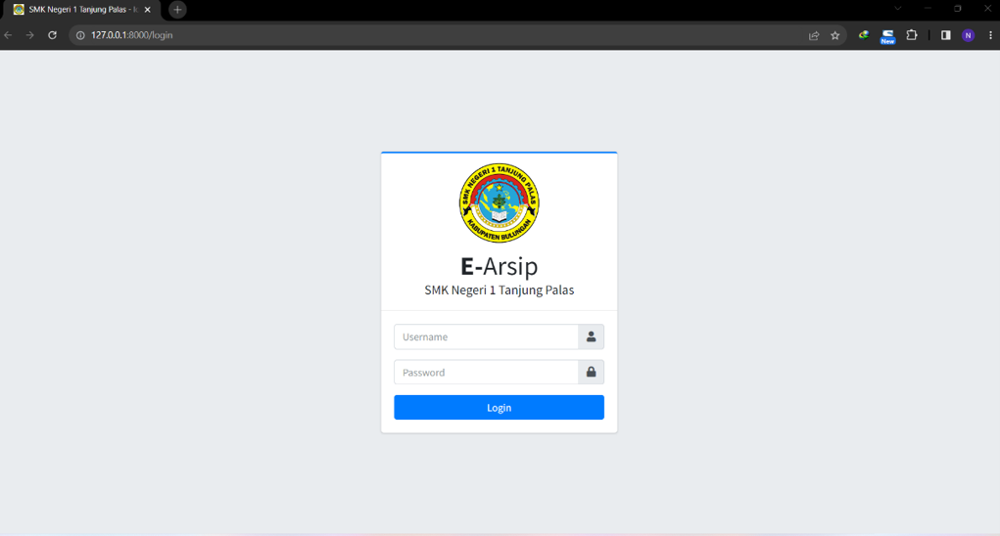

### Dashboard
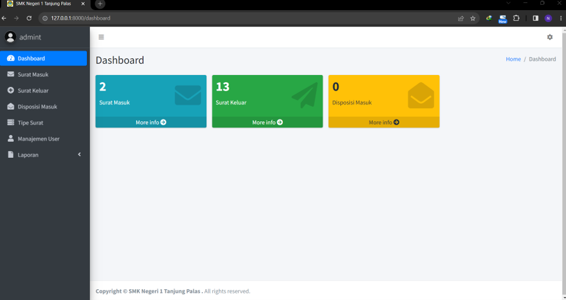

### Pengelolaan Surat Masuk
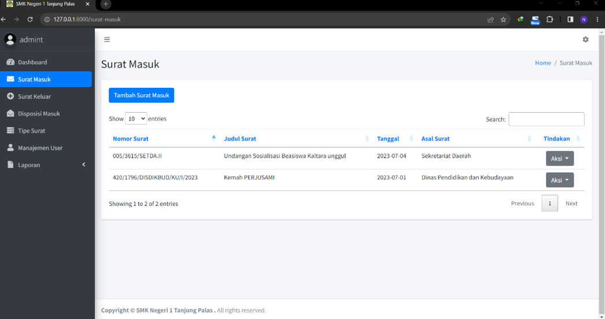

### Pengelolaan Surat Keluar
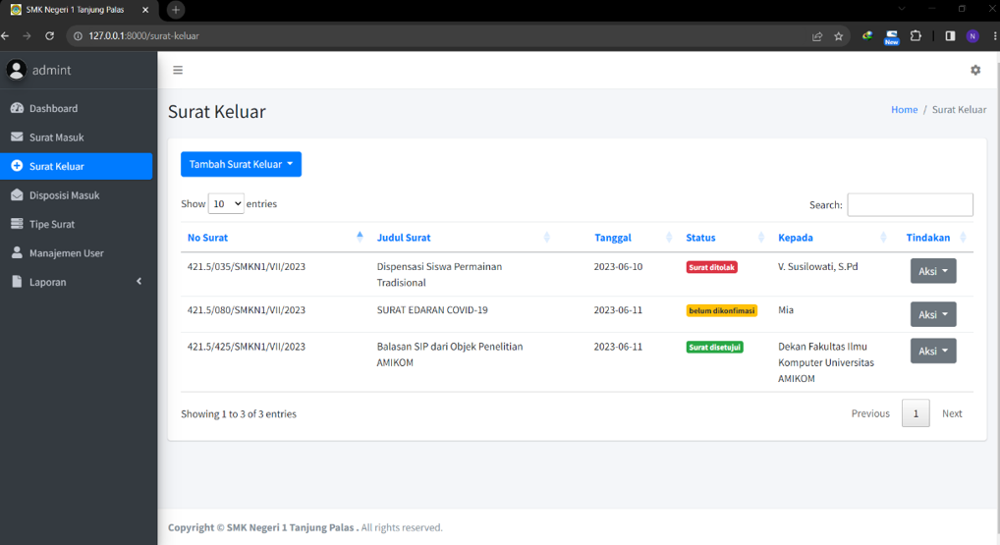

### Disposisi
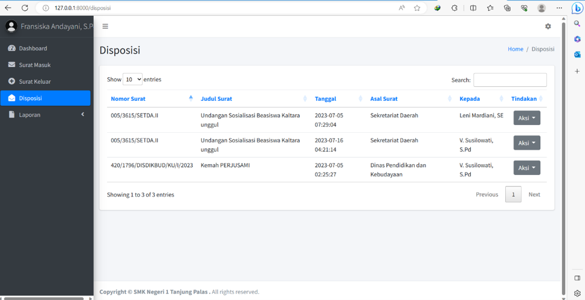

### Tambah surat
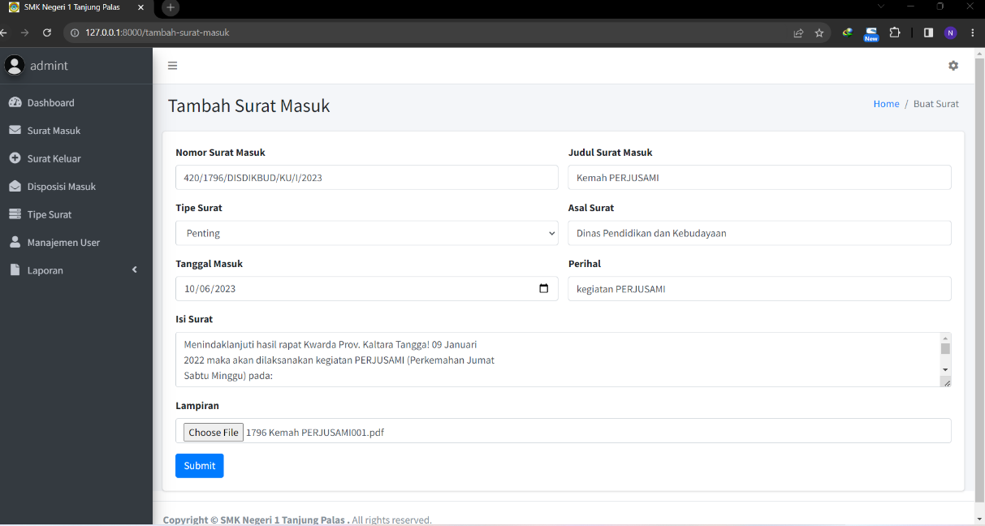

### Detail Surat
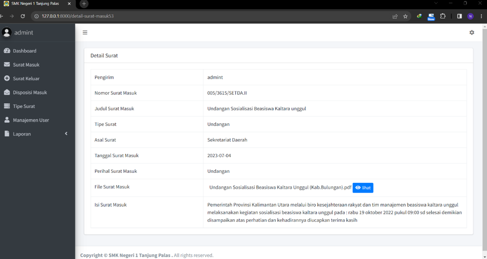

### Edit Surat
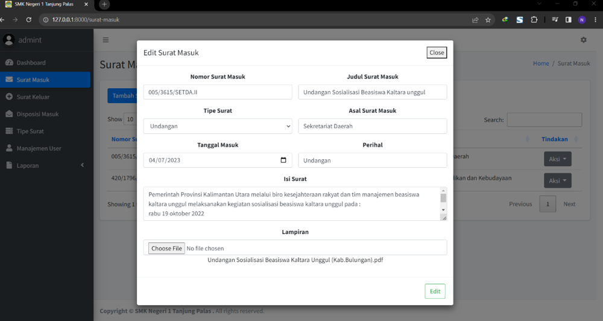

### Pengelolaan Tipe Surat
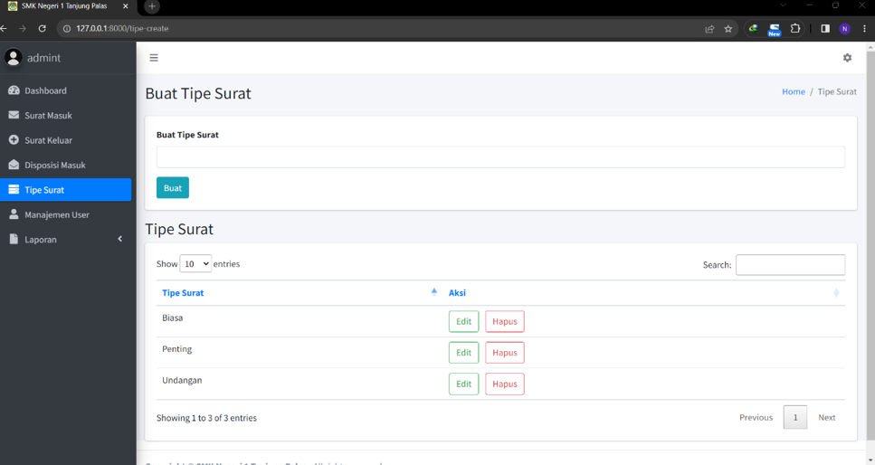

### Manajemen Pengguna
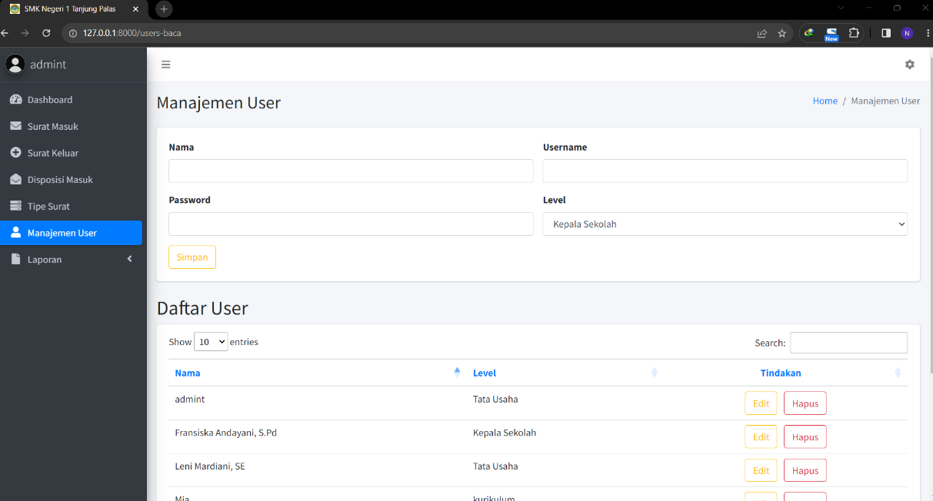

### Laporan Surat
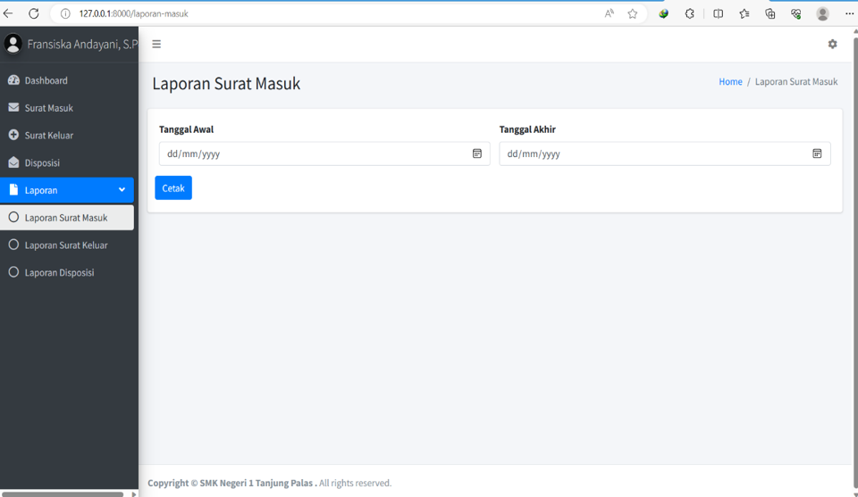

### Hasil Laporan Surat 
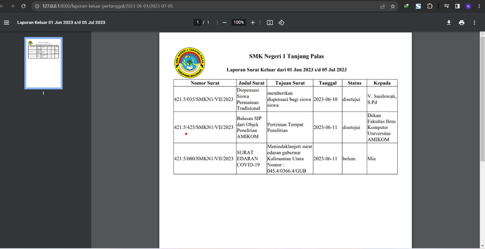


